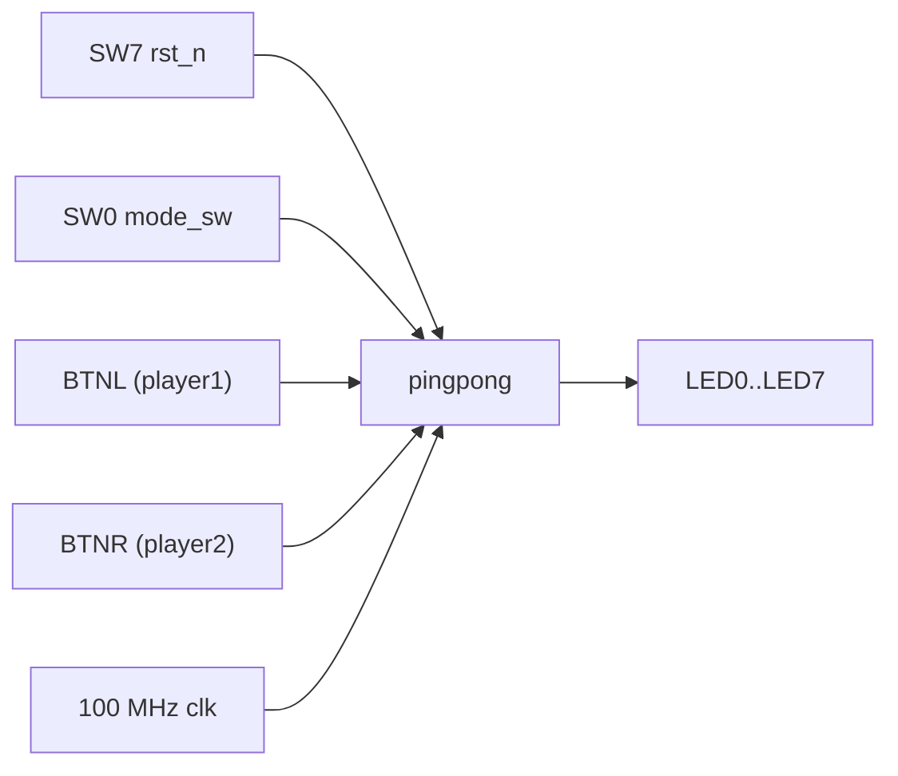
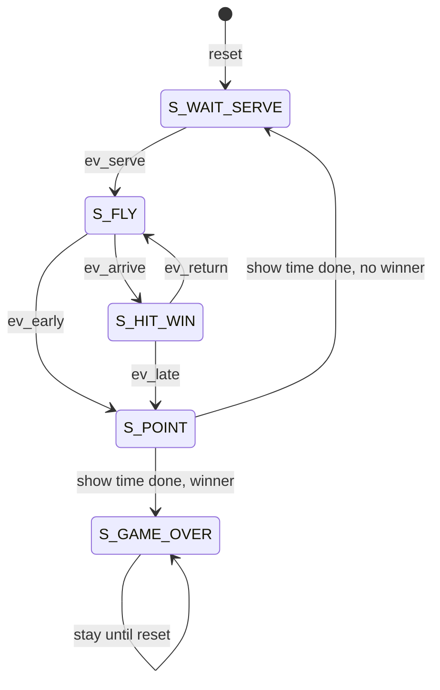

# 02 分析（Analysis）

> 軟體開發五個週期的第 2 階段。把需求轉成明確的行為模型：有哪些狀態、哪些事件、時間怎麼算、硬體有什麼限制。

## 2.1 系統情境

| 方向 | 訊號 | 說明 |
|---|---|---|
| 輸入 | `clk` | 100 MHz |
| 輸入 | `rst_n` | SW7，低 = reset |
| 輸入 | `mode_sw` | SW0，0 勻速、1 變速 |
| 輸入 | `btn_l`、`btn_r` | 兩位玩家的回擊鍵 |
| 輸出 | `led[7:0]` | 球位置、分數（二進位）、勝負 |

## 2.2 硬體資源

來源：*EGO-XZ7 硬體手冊 V1.2*（E-Elements，2017/3/25）。

| 資源 | 內容 | 手冊位置 | 狀態 |
|---|---|---|---|
| PL 時脈 | 100 MHz，腳位 Y9 | 4.3 節、表 2（第 13–14 頁） | 手冊查證 |
| LED0–LED7 | T22, T21, U22, U21, V22, W22, U19, U14 | 表 15（第 26–27 頁） | 手冊查證 |
| SW0–SW7 | F22, G22, H22, F21, H19, H18, H17, M15 | 表 15 | 手冊查證 |
| 按鍵 | BTNU T18、BTNC P16、BTNL N15、BTNR R18、BTND R16 | 表 15 | 手冊查證 |
| FPGA 型號 | XC7Z020-CLG484-1 | 4.1 節、圖 2 | 手冊查證 |
| JTAG 配置 | SW8[4:2] = 000，經 J1（MicroUSB） | 表 4、表 5（第 15 頁） | 手冊查證 |
| IO 標準 | LVCMOS33 | 手冊**未記載** | 使用者提供（課程板子一律使用） |
| 按鍵極性 | 按下為高電位 | 手冊原理圖（圖 22）下拉電阻 | **推論** |
| 七段顯示 | 手冊記載一顆（D1）A–G 腳位 | 表 16、圖 23 | 實測無法點亮，**已棄用** |

## 2.3 遊戲邏輯分析

**座標與方向**

- 球位置 `pos` = 0..7，LED0（pos 0）在板子最下方，為 player1 端；LED7（pos 7）為 player2 端。
- `dir = 1` 表示球往 player2 飛，`dir = 0` 表示往 player1 飛。**接球者就是 `dir` 指向的人。**

**一次完整回合**

1. 發球者按鍵 → 球立刻離開發球端一格 → 之後每個 tick 再走一格。
2. 球走到接球端 → 進入「回擊窗口」，長度為一步時間。
3. 窗口內接球者按鍵 → 球反向立刻離開端點，進入下一趟。
4. 窗口結束沒按（太晚）或飛行中按鍵（太早）→ 接球者失分。

**重要不變量**

- 失分的人一定是接球者，所以得分者 = 接球者的對面 = `not dir`。太早、太晚用同一條規則計分。
- 得分者就是下一個發球者，球從他那一端往對面飛，方向恰好還是原來的 `dir`，不需要額外處理。

**球走幾步**

發球時球從 pos 0 立刻移到 pos 1，之後 6 個 tick 走到 pos 7 → 抵達端點共 6 步時間。回擊後同理。

## 2.4 狀態分析

| 狀態 | 意義 | 計時 | LED 顯示 |
|---|---|---|---|
| `S_WAIT_SERVE` | 等發球者按鍵，球停在發球者端 | 不計時 | 球 |
| `S_FLY` | 球飛行，每步一格 | 一步時間 | 球 |
| `S_HIT_WIN` | 球在端點，等回擊 | 一步時間 | 球 |
| `S_POINT` | 顯示得分 | `SHOW_TIME` | 前半：得分者的 4 位元二進位；後半：全暗 |
| `S_GAME_OVER` | 有人達到 `WIN_SCORE` | 不計時 | 勝方四顆 LED 恆亮 |

## 2.5 事件與優先順序

事件由「目前狀態 + 輸入」組合決定，全部是當拍有效的單一 clock 事件。

| 事件 | 條件 | 結果 |
|---|---|---|
| `ev_serve` | `S_WAIT_SERVE` 且發球者按鍵 | → `S_FLY`，球移一格，更新速度 |
| `ev_early` | `S_FLY` 且**接球者**按鍵 | → `S_POINT` |
| `ev_step` | `S_FLY` 且 tick 且接球者沒按 | 球移一格 |
| `ev_arrive` | `ev_step` 且下一格就是端點 | → `S_HIT_WIN` |
| `ev_return` | `S_HIT_WIN` 且接球者按鍵 | → `S_FLY`，球反向並離開端點，更新速度 |
| `ev_late` | `S_HIT_WIN` 且 tick 且接球者沒按 | → `S_POINT` |

**優先順序（同一拍同時發生時）**

- 在 `S_HIT_WIN`：按鍵 > 時間到（對玩家有利）。
- 在 `S_FLY`：按鍵（太早）> 抵達端點。
- 非接球者的按鍵、發球前非發球者的按鍵：一律忽略。

## 2.6 時間分析

CLK = 100 MHz，1 ms = 100,000 個 clock。

| 項目 | 預設 | clock 數 |
|---|---|---|
| 勻速每步 | 250 ms | 25,000,000 |
| 變速每步 | 150 + 亂數 × 100 ms（亂數 0..3，即 150／250／350／450 ms） | 15,000,000 ～ 45,000,000 |
| 得分顯示 | 1000 ms | 100,000,000 |
| 去彈跳 | 10 ms | 1,000,000 |

- 計數器最大值為 100,000,000，27 bit 最大 134,217,727，裝得下，所以寬度定為 27 bit。
- 回擊窗口等於一步時間，變速最快時只有 150 ms。**這是否太緊是推論，須上板實測後調整參數。**

## 2.7 隨機變速分析

- 「計數器的 MSB」只是固定週期的方波，不是亂數；若當作 clock 還會破壞單一 clock 的同步設計，因此不採用。
- 採用 **8 bit LFSR**：持續以 100 MHz 運轉，在有效回擊的那一刻取樣低 `RAND_BITS` 個 bit。人按鍵的時間對 10 ns 來說可視為隨機，但此為確定性偽隨機序列，不保證不可預測或均勻取樣。
- LFSR 狀態不可為全 0，因此 reset 時設為非零種子。
- 取樣只在回擊（含發球）時發生，一趟飛行內速度固定，窗口長度可預期（已列為 FR-09 的現行規則）。

## 2.8 輸入處理分析

- 按鍵、開關與 clock 不同步，直接取樣有亞穩態風險 → 以 2 級同步器降低風險，無法保證完全消除。
- 機械按鍵會彈跳 → 需去彈跳（穩定超過 `DEBOUNCE_MS` 才接受）。
- 按鍵要「按一次 = 一個事件」→ 需邊緣偵測，輸出單一 clock 脈波。
- `rst_n` 也是撥動開關，同樣要同步；上電初值為「reset 中」，讀到開關為高才開始運作。

## 2.9 以成品證據修正風險

| 項目 | 查核結果 | 影響與後續 |
|---|---|---|
| Implementation／bitstream | 2026-11-11 runme 記錄成功，包內有 bitstream | 原本「尚未產生 bitstream」不適用此成品；家用環境 OOM 原因仍未確定 |
| 時序 | routed 報告 WNS 2.690 ns、WHS 0.180 ns，違反總量均為 0 | 只代表已設定的時序約束通過 |
| 外部 I/O 時序 | methodology 有 12 個 TIMING-18（4 輸入、8 輸出缺延遲） | 不能宣稱所有外部介面時序已驗證；非同步按鍵及無同步接收端 LED 須依實際介面建模，不能任意補數字消警告 |
| 七段 | 已移除介面與約束，作者回報實驗時未能以當時方案控制 | 棄用是已確認決策；不能推論所有七段都不能以程式控制，或此板硬體必定故障 |
| 測試 T7 | 舊碼量到部分步長；此次改量完整相鄰 LED 區間後通過 | 詳見驗證文件；尚非完整隨機分布測試 |
| 板卡設定 | 原 xpr 有 zc702 board_part，實際 part 為 xc7z020clg484-1 | 重建腳本直接選 part，避免照抄錯誤板卡設定 |
| Generic | 實驗室 WIN_SCORE=1..9；時間須容納於 27 bit | 未驗證每個參數組合；改 RAND_BITS 時須重查上界 |

硬體腳位沿用成品 XDC，並與實驗室 I/O 報告核對；硬體手冊來源仍為前次交接記載，未把前次推論升格為本次實測。
