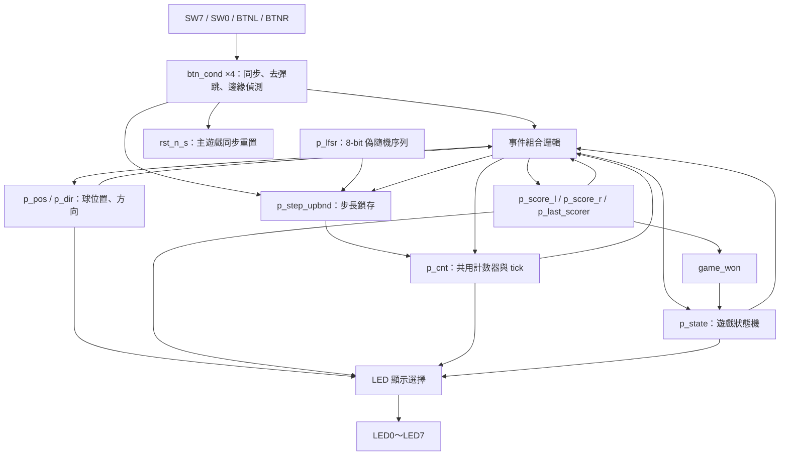
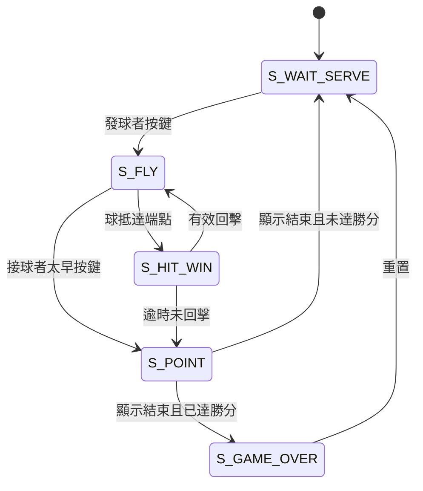

# 03 系統設計

## 系統架構

所有暫存器皆使用共同 clk 上升緣。rst_n_s 重置主遊戲暫存器；btn_cond 自身由初值啟動。方塊中列出的 process 分別驅動各自訊號。

## 狀態機

重置對全部遊戲狀態有效，回到 Player 1 等待發球並清除分數。發球與回擊時球立即離開端點，之後每個 tick 移動一格。

## 暫存器分工

| 訊號 | 驅動 process | 更新規則 |
|---|---|---|
| state | p_state | 依發球、到達、回擊、失誤及顯示完成事件轉移 |
| cnt | p_cnt | 計時；tick、太早失誤、有效回擊或停止計時時歸零 |
| pos | p_pos | 發球、回擊、移動事件時增減；等待及得分時回到發球端 |
| dir | p_dir | 回擊時反向；等待時指向發球者對面 |
| last_scorer | p_last_scorer | 失誤時記錄接球者對手 |
| score_l、score_r | p_score_l、p_score_r | 對手失誤時加 1，分別由獨立 process 更新 |
| lfsr | p_lfsr | 每拍更新偽隨機序列 |
| step_upbnd | p_step_upbnd | 發球或有效回擊時鎖存勻速值或 LFSR 對應步長 |

btn_cond 以 sync_ff、db_cnt、stable、prev 分別實作同步、去彈跳與邊緣偵測，每個訊號亦各有單一驅動來源。

## 顯示邏輯

等待發球、飛行和回擊窗口使用 gen_ball 產生單顆球燈。得分狀態由 score_bits 選出得分者分數，gen_score 映射至該方四顆 LED，並以 cnt 與 SHOW_CYC / 2 比較控制亮暗。勝利狀態優先顯示勝方四顆恆亮。

所有 LED 圖樣經單一輸出選擇指定給 led，無七段輸出或額外顯示時脈。

## 參數

| Generic | 預設 | 用途 |
|---|---|---|
| CLK_HZ | 100,000,000 | 系統時脈 |
| WIN_SCORE | 5（範圍 1～9） | 獲勝分數 |
| RAND_BITS | 2（範圍 1～4） | LFSR 取樣位數 |
| CONST_STEP_MS | 250 | 勻速步長 |
| STEP_MIN_MS、STEP_UNIT_MS | 150、100 | 變速基準與間距 |
| SHOW_TIME_MS | 1,000 | 得分顯示時間 |
| DEBOUNCE_MS | 10 | 去彈跳時間 |

時間換算以 CLK_HZ / 1000 計算；計數器寬度為 27 bit。RTL 包含時間容量與最小步長 assert，參數變更後仍須重新驗證。
