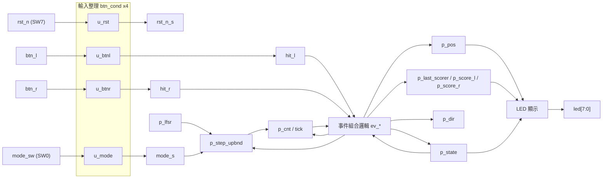

# 03 設計（Design）

> 軟體開發五個週期的第 3 階段。把分析結果轉成可實作的架構：模組、參數、訊號、時序與設計決策。
> 對應程式：`src/pingpong.vhd`、`src/btn_cond.vhd`。

## 3.1 設計原則

1. **單一 clock、同步設計**：全部 process 都在 `clk` 上升緣動作，時間用 enable 脈波（`tick`）表示，不產生衍生 clock。
2. **一個 signal 一個驅動來源**：每個暫存器 signal 只由一個 process 驅動；組合邏輯用並行指定。
3. **事件驅動**：先由「狀態 + 輸入」組合出事件（`ev_*`），各暫存器 process 只看事件更新自己。
4. **參數集中**：時間、分數、亂數 bit 數都是 `generic`，改一處即可。

## 3.2 架構

| 模組 | 檔案 | 功能 |
|---|---|---|
| `pingpong` | `src/pingpong.vhd` | 頂層：FSM、計時、球位置、計分、亂數、顯示 |
| `btn_cond` | `src/btn_cond.vhd` | 2 級同步器 → 去彈跳 → 準位與上升沿脈波；頂層實例化 4 次（rst、mode、btn_l、btn_r） |

## 3.3 Generic 參數

| 名稱 | 預設 | 範圍 | 說明 |
|---|---|---|---|
| `CLK_HZ` | 100,000,000 | | 時脈頻率 |
| `WIN_SCORE` | 5 | 1..15 | 獲勝分數（4 位元二進位最多 15；實測只用 5） |
| `RAND_BITS` | 2 | 1..4 | 變速時取樣的 LFSR bit 數，亂數範圍 0..2^RAND_BITS-1 |
| `CONST_STEP_MS` | 250 | | 勻速每步時間 |
| `STEP_MIN_MS` | 150 | | 變速最短每步時間 |
| `STEP_UNIT_MS` | 100 | | 亂數每加 1 增加的時間 |
| `SHOW_TIME_MS` | 1000 | | 得分顯示時間 |
| `DEBOUNCE_MS` | 10 | | 去彈跳時間 |

程式內有兩個 `assert`：時間參數超出計數器 27 bit 範圍、或每步時間不足 2 個 clock，會在編譯／合成時報錯。

## 3.4 埠與腳位

| 埠 | 方向 | 型別 | 腳位 | 說明 |
|---|---|---|---|---|
| `clk` | in | `std_logic` | Y9 | 100 MHz |
| `rst_n` | in | `std_logic` | M15（SW7） | 低 = reset |
| `mode_sw` | in | `std_logic` | F22（SW0） | 0 勻速，1 變速 |
| `btn_l` | in | `std_logic` | N15（BTNL） | player1 |
| `btn_r` | in | `std_logic` | R18（BTNR） | player2 |
| `led` | out | `std_logic_vector(7 downto 0)` | T22, T21, U22, U21, V22, W22, U19, U14 | LED0..LED7 |

腳位來源：硬體手冊 V1.2 表 2、表 15。IO 標準 LVCMOS33 為使用者提供。

## 3.5 內部訊號

**暫存器（各只有一個 process 驅動）**

| 訊號 | 型別／寬度 | 驅動 process | 說明 |
|---|---|---|---|
| `state` | 列舉 `state_t` | `p_state` | `S_WAIT_SERVE`、`S_FLY`、`S_HIT_WIN`、`S_POINT`、`S_GAME_OVER` |
| `cnt` | `unsigned(26 downto 0)` | `p_cnt` | 計時 |
| `pos` | `unsigned(2 downto 0)` | `p_pos` | 球位置 0..7 |
| `dir` | `std_logic` | `p_dir` | 1 = 往 player2，0 = 往 player1 |
| `last_scorer` | `std_logic` | `p_last_scorer` | 最近得分者，也是發球者；0 = player1 |
| `score_l`、`score_r` | `integer range 0 to WIN_SCORE` | `p_score_l`、`p_score_r` | 分數 |
| `lfsr` | `std_logic_vector(7 downto 0)` | `p_lfsr` | 偽隨機，種子 `x"A5"` |
| `step_upbnd` | `unsigned(26 downto 0)` | `p_step_upbnd` | 目前這一趟的每步 clock 數 |

**`btn_cond` 內部**：`sync_ff`（`p_sync_ff`）、`db_cnt`（`p_db_cnt`）、`stable`（`p_stable`）、`prev`（`p_prev`），各一個 process。

**並行（組合）訊號**

| 訊號 | 說明 |
|---|---|
| `cnt_en` | 在 `S_FLY`、`S_HIT_WIN`、`S_POINT` 時為 1 |
| `upbnd` | `S_POINT` 用 `SHOW_CYC`，其餘用 `step_upbnd` |
| `tick` | `cnt_en = 1` 且 `cnt = upbnd - 1`；每個計時區間剛好 `upbnd` 個 clock |
| `rx_hit` | 接球者按鍵：`(hit_r and dir) or (hit_l and not dir)` |
| `sv_hit` | 發球者按鍵：`(hit_l and not last_scorer) or (hit_r and last_scorer)` |
| `at_last` | 下一步就到端點：`(dir=1 and pos=6) or (dir=0 and pos=1)` |
| `move_dir` | 回擊時用反向，其他時候用 `dir` |
| `ev_serve` … `ev_late` | 見 02 分析 2.5 節 |
| `ev_point` | `ev_early or ev_late` |
| `ev_move` | `ev_serve or ev_return or ev_step` |
| `game_won` | 任一方分數等於 `WIN_SCORE` |
| `ball_leds` | 球位置獨熱碼 |
| `score_bits` | 得分者的分數（`unsigned(3 downto 0)`） |
| `score_leds` | 二進位顯示用的 8 顆 LED 圖樣 |

## 3.6 各暫存器更新規則

| 訊號 | 更新條件 |
|---|---|
| `state` | 依 02 分析的狀態轉移 |
| `cnt` | `cnt_en = 0`、`tick`、`ev_early` 或 `ev_return` 時歸零，否則 +1。`ev_arrive`、`ev_late` 本身都含 `tick`，也會歸零 |
| `pos` | `ev_move`：依 `move_dir` ±1；否則在 `S_WAIT_SERVE`、`S_POINT` 期間停在發球者端（0 或 7） |
| `dir` | `ev_return`：反向；`S_WAIT_SERVE`：設為 `not last_scorer` |
| `last_scorer` | `ev_point`：設為 `not dir` |
| `score_l` | `ev_point` 且 `dir = 1`（player2 失分）且未滿分：+1 |
| `score_r` | `ev_point` 且 `dir = 0`（player1 失分）且未滿分：+1 |
| `lfsr` | 每個 clock 左移，回授為 bit7 xor bit5 xor bit4 xor bit3 |
| `step_upbnd` | `ev_serve` 或 `ev_return`：勻速取 `CONST_STEP_CYC`；變速取 `STEP_MIN_CYC + lfsr[RAND_BITS-1:0] × STEP_UNIT_CYC` |

所有暫存器在 `rst_n_s = '0'` 時同步重置。

## 3.7 顯示設計

| 狀態 | `led` |
|---|---|
| `S_WAIT_SERVE`、`S_FLY`、`S_HIT_WIN` | 球位置（獨熱） |
| `S_POINT`，`cnt < SHOW_CYC / 2` | 得分者的 4 位元二進位分數，另一半邊熄滅 |
| `S_POINT`，`cnt >= SHOW_CYC / 2` | 全暗 |
| `S_GAME_OVER` | 勝方四顆 LED 恆亮（player1 = `00001111`，player2 = `11110000`） |

二進位對應：

| 得分者 | 最高位元 → 最低位元 |
|---|---|
| player1（`last_scorer = 0`） | LED0、LED1、LED2、LED3 |
| player2（`last_scorer = 1`） | LED4、LED5、LED6、LED7 |

| 得分 | 二進位 | player1 亮燈 | player2 亮燈 |
|---:|---|---|---|
| 1 | 0001 | LED3 | LED7 |
| 2 | 0010 | LED2 | LED6 |
| 3 | 0011 | LED2、LED3 | LED6、LED7 |
| 4 | 0100 | LED1 | LED5 |
| 5 | 0101 | LED1、LED3 | LED5、LED7 |

第 5 分：先顯示一次「0101 → 熄滅」，再進入 `S_GAME_OVER` 的恆亮畫面，**不是**長亮 0101。

## 3.8 LFSR

- 多項式 x^8 + x^6 + x^5 + x^4 + 1，8 bit，XOR 回授。
- 以 `tools/lfsr_check.py` 驗證：從種子 `0xA5` 出發，週期 **255**，走完 255 個不同狀態後回到種子。
- 全 0 為鎖死狀態，種子非零所以不會進入。

## 3.9 設計決策紀錄

| 編號 | 決策 | 理由 | 替代方案 |
|---|---|---|---|
| D-01 | 事件用並行訊號，暫存器 process 只看事件 | 一個 signal 一個 process，邏輯不重複，易除錯 | 單一大 process 控制全部（較難維護） |
| D-02 | 用 LFSR 當亂數來源 | 序列不規律、電路小 | 計數器 MSB：只是規律方波，不是亂數，不採用 |
| D-03 | 只在發球／有效回擊時取樣亂數 | 同一趟速度固定，回擊窗口長度可預期 | 每步取樣：窗口長度也隨機，判定較不公平 |
| D-04 | 發球與回擊時球**立刻**離開端點 | 按下去馬上有視覺回饋 | 等一步時間才移動（球會在端點多停一下） |
| D-05 | 同拍按鍵與時間到，按鍵優先 | 對玩家有利，避免 10 ns 尺度的不公平 | 時間優先 |
| D-06 | 太早、太晚共用「接球者失分」規則 | 得分者 = `not dir`，不需要額外分支 | 兩套規則 |
| D-07 | 分數用 LED 二進位，顯示的前半亮、後半熄滅；勝利用勝方四顆恆亮 | 七段實測無法點亮；二進位只需 LED、不增加計數器（用 `cnt` 比較一半時間即可）；熄滅讓第 1 分和發球端的球 LED 可以區分 | 七段（v1.0，棄用）、LED 長條（v1.1，被使用者的二進位需求取代） |
| D-08 | 所有輸入同步、去彈跳，`rst_n` 也一樣 | 避免亞穩態與彈跳；上電初值為 reset，較安全 | 直接使用輸入 |
| D-09 | 參數集中為 generic，並用 `assert` 檢查範圍 | 避免魔術數字，錯誤在編譯／合成時就會被發現 | 寫死在程式 |
| D-10 | `dir` 在 `S_WAIT_SERVE` 重新對準 `not last_scorer` | 讓「得分者發球」的不變量由電路自己保證，出錯時會自動校正 | 只靠推導，不顯式指定 |

## 3.10 需求對應

| 需求 | 設計位置 |
|---|---|
| FR-01 | `btn_l`、`btn_r`、`rx_hit`、`sv_hit` |
| FR-02 | `pos`、`ball_leds`、`led` |
| FR-03 | `p_state` 的 `S_WAIT_SERVE`、`sv_hit`、`ev_serve`、`last_scorer` |
| FR-04 | `ev_return`、`p_dir` |
| FR-05 | `ev_late` |
| FR-06 | `ev_early`、`rx_hit` 只看接球者 |
| FR-07 | `game_won`、`S_GAME_OVER`、`led` 的勝方恆亮 |
| FR-08 | `score_bits`、`score_leds`、`led`（比較 `cnt` 與 `HALF_SHOW_CYC`） |
| FR-09 | `lfsr`、`p_step_upbnd`、`mode_s` |
| FR-10 | `rst_n_s`（所有 process 的同步 reset） |
| FR-11 | `btn_cond` |
| NFR-01..03 | 3.1、3.3、3.6 |
