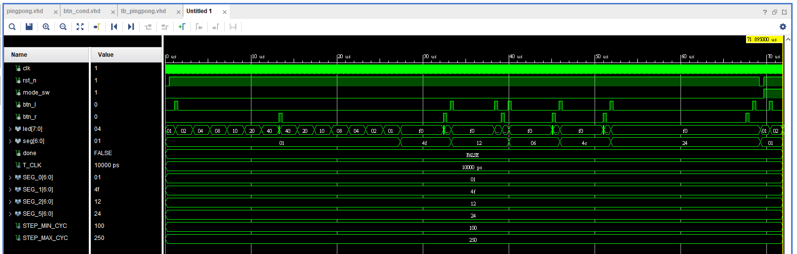
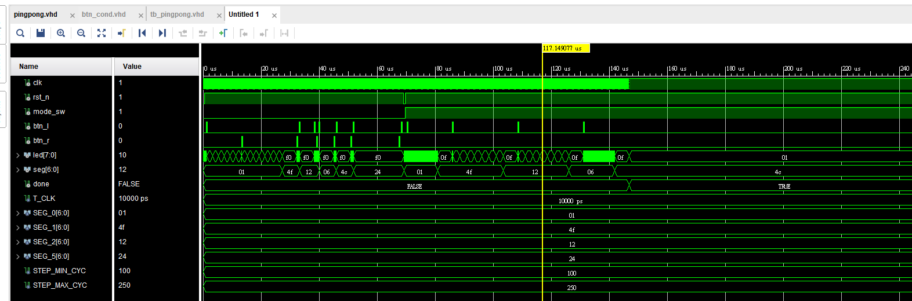
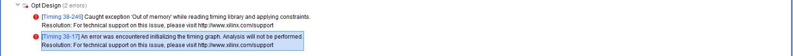
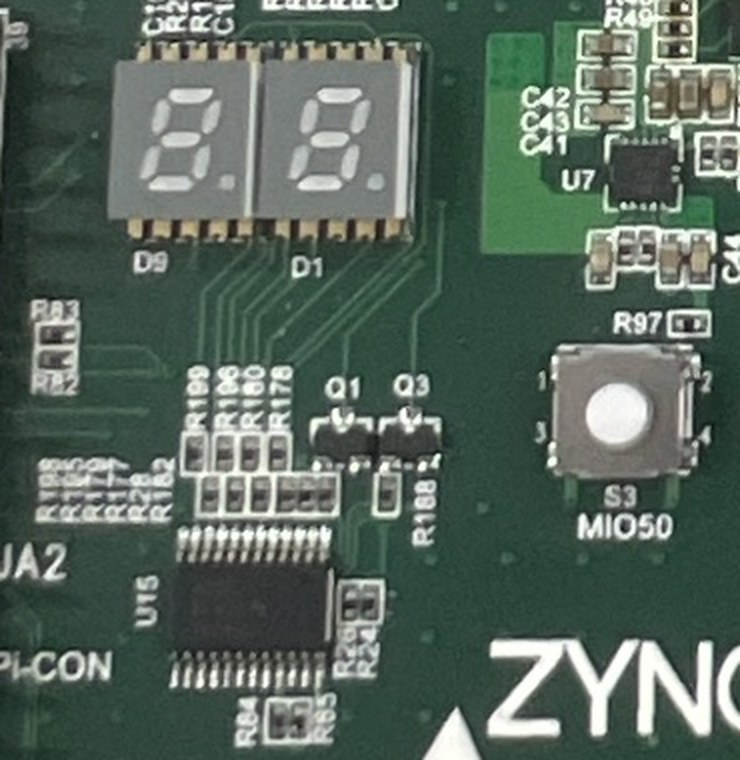

# 05 驗證（Verification）

> 軟體開發五個週期的第 5 階段。說明怎麼驗證、驗證到哪裡、哪些還沒驗證。
> **本文件刻意誠實記錄狀態：沒有跑過的測試不會寫成通過。**

## 5.1 驗證策略

1. **模擬**：自我檢查 testbench，用縮短的時間參數快速跑完所有情境。
2. **上板**：把 bitstream 燒進 EGO-XZ7，用人工操作確認行為與手感。
3. **審查**：LFSR 週期用 Python 驗證；其餘靠設計審查。

## 5.2 Testbench 內容（`sim/tb_pingpong.vhd`）

時間縮短：`CLK_HZ = 10_000`（1 ms = 10 clk）→ 去彈跳 10 clk、勻速一步 200 clk、得分顯示 500 clk（前 250 clk 亮、後 250 clk 熄滅）。

| 測項 | 情境 | 檢查 | 對應需求 |
|---|---|---|---|
| T1 | reset 後 | LED0 亮 | FR-02、FR-03、FR-10 |
| T2 | player1 發球 → 球飛到 LED7 → player2 有效回擊 → 球飛回 LED0 | 球位置序列、回擊後反向 | FR-03、FR-04 |
| T3 | player1 在端點不按（太晚） | player2 得 1 分：LED7 亮（0001）→ 熄滅 → 球回到 LED7 發球端 | FR-05、FR-08 |
| T4 | player2 發球後，player1 飛行中按鍵（太早） | player2 得 2 分：LED6 亮（0010）→ 熄滅 → 回到發球端 | FR-06、FR-08 |
| T5 | 等待發球時，非發球者按鍵 | LED 不變 | FR-03 |
| T6 | player2 連得 3 分達 5 分 | 依序顯示 0011、0100、0101；第 5 分後 LED4–LED7 恆亮；按鍵無效 | FR-07、FR-08 |
| T7 | reset 後切變速，連打 4 球 | 每步 clock 數落在 [100, 250]±2 並印出；player1 得 1–4 分的二進位圖樣正確 | FR-08、FR-09 |

通過時 console 會印 `ALL TESTS PASSED`；任何 `assert` 失敗（`severity failure`）會停止模擬。T7 另外會印 `T7 round n: step = ... clk`。

> T4 顯示的 0010（LED6）與「球在 LED6」的圖樣相同，單看圖樣區分力較弱；T6 的 0011／0100／0101 圖樣與球位置不同，區分力較強。

## 5.3 執行方式（Vivado）

1. 把 `sim/tb_pingpong.vhd` 設為模擬頂層（`tb_pingpong`）。
2. Run Simulation → Run Behavioral Simulation。
3. Tcl Console 輸入 `run all`。
4. 看 Tcl Console 是否出現 `ALL TESTS PASSED`，並查看 T7 印出的步長。

想看內部狀態：`add_wave -r /tb_pingpong` 後再 `restart`、`run all`。（Tcl 指令為憑記憶撰寫，若報錯請依 Vivado 提示調整。）

## 5.4 驗證結果

| 版本／項目 | 結果 | 依據 |
|---|---|---|
| **v1.0（七段版）模擬** | 完整跑完：`done` 在約 145 µs 變為 TRUE；T1–T6 的 LED 序列與預期吻合；T7 四輪皆由 player1 得分 | 使用者在 Vivado 的波形截圖 `images/sim_7seg_v1.0_part1.png`、`part2.png`。**未取得 Tcl Console 文字輸出**，`ALL TESTS PASSED` 與 T7 步長數值未確認 |
| **v1.0 上板（使用者回報）** | LED0–LED7 球移動正常；按 BTNL 球往右（LED7 方向）移；得 5 分後勝方那半邊四顆 LED 恆亮 | 使用者口頭回報，無影片或照片 |
| v1.0 七段 | **不亮**（見 5.7） | 使用者回報 |
| **v1.2（目前版本，二進位計分）模擬** | **尚未執行** | testbench 已改寫，尚未在 Vivado 跑過 |
| **v1.2 編譯／合成** | **尚未確認** | 撰寫環境沒有 VHDL 工具 |
| **v1.2 Implementation** | **失敗：Out of memory**（見 5.6）。這是工具環境錯誤，**不能**據此判定設計有邏輯錯誤 | 使用者的 Vivado 截圖 `images/vivado_2018_3_opt_design_oom.png` |
| v1.2 上板 | **尚未執行** | |
| LFSR 週期 | 通過：週期 255，回到種子 | `python3 tools/lfsr_check.py` |

## 5.5 需求追溯與測試缺口

| 需求 | 測試 | 狀態 |
|---|---|---|
| FR-01 | 上板 | v1.0 上板：按鍵可操作（使用者回報），左右對應未正式記錄 |
| FR-02 | T1、T2 | v1.0 模擬看似通過、上板球移動正常；v1.2 待跑 |
| FR-03 | T1、T2、T5 | 同上 |
| FR-04 | T2 | 同上 |
| FR-05 | T3 | 同上 |
| FR-06 | T4 | 同上。**缺口**：「球飛離自己時按鍵被忽略」沒有專屬測項 |
| FR-07 | T6 | v1.0 上板確認勝方四顆恆亮；v1.2 待跑 |
| FR-08 | T3、T4、T6、T7 | **v1.2 的二進位與熄滅尚未模擬、尚未上板** |
| FR-09 | T7 | v1.0 看似通過；步長數值待確認 |
| FR-10 | T1、上板 | 使用者回報 SW7 上 = 運作、下 = reset 符合預期 |
| FR-11 | （無） | **缺口**：沒有模擬按鍵彈跳 |

其他缺口：同拍按鍵與時間到的優先順序、遊戲進行中 reset、變速亂數是否真的分布在各檔位。

## 5.6 Vivado 記憶體不足（未解決）

**現象**：使用者在 Vivado 2018.3（Windows，電腦 8 GB RAM）對目前版本執行 Run Implementation，在 `opt_design` 階段失敗：

- `[Timing 38-246] Caught exception 'Out of memory' while reading timing library and applying constraints.`
- `[Timing 38-17] An error was encountered initializing the timing graph. Analysis will not be performed.`
- 同一次畫面還有 `[Labtoolstcl 44-513] HW Target shutdown`，這是硬體目標連線關閉的紀錄，**不足以證明**與記憶體錯誤有因果關係。

**已知／未知**

- 已知：錯誤發生在 Implementation 讀取時序資料庫與套用約束的階段。
- 未知：真正原因。這個設計很小（推論，沒看過資源使用報告），照理不會需要大量記憶體，所以較像是**電腦或 Vivado 的環境問題**，而不是新的顯示邏輯造成。這是推論。

**可以嘗試的處理（皆為建議，未經實測）**

1. 關閉其他程式、重新開機，只開一個 Vivado；先關閉 Hardware Manager 連線再跑 Implementation。
2. 確認 Windows 虛擬記憶體（Page File）已啟用，優先「系統管理大小」；磁碟要有足夠剩餘空間。手動設定 12–24 GB 只是排錯嘗試，不是 Vivado 的官方硬性設定。
3. Design Runs 中重設失敗的 `impl_1` 後重新執行，Number of jobs 設為 1。
4. 改用不開 GUI 的批次流程：`vivado -mode batch -source scripts/build_batch.tcl`（腳本含 `set_param general.maxThreads 1`；**未實際執行過，是否能避開錯誤未知**）。
5. 仍失敗時，保存 `<專案>.runs/impl_1/runme.log` 末段與工作管理員記憶體畫面，再判斷。

## 5.7 七段顯示器調查（已結案：棄用）

**現象（使用者回報）**

- 不論輸出全 0 或全 1，七段都不亮。
- 獨立的七段測試設計（輸出全 0，只含七段腳位約束）也不亮。
- Vivado I/O Ports 檢視中，七段腳位為 OUT、LVCMOS33、Bank 13（Vcco 3.3 V），與 XDC 一致。這只能說明約束套用正確，**不代表七段硬體正常**。

**已知事實**

- 硬體手冊 V1.2 只記載一顆七段 D1 的 A–G 腳位（表 16），原理圖（圖 23）共用腳經 R65（0 Ω）接 +3.3V，未見額外位選線。
- 實板（Ver.B）有**兩顆**七段：左 D9、右 D1，旁邊有兩個電晶體 Q1、Q3 與數個電阻。

**推論（未證實）**：Ver.B 可能以電晶體切換位選，或有其他電路因素；沒有量測共用腳電壓或段線電位。**不可據此斷言七段硬體故障。**

**決定**：使用者決定棄用七段，分數改用 LED 二進位顯示。專案不再包含七段腳位約束，診斷設計封存於 `archive/seg_test/`。

## 5.8 上板驗證清單（v1.2）

| 項目 | 預期 | 結果 |
|---|---|---|
| 產生 bitstream | Implementation 成功 | **失敗：Out of memory（5.6）** |
| SW7 往下／往上 | reset／運作 | v1.0 已回報符合；v1.2 待測 |
| 待發球 | player1 端 LED0 亮 | 待測 |
| BTNL／BTNR | 左側鍵為 player1、右側鍵為 player2 | v1.0 BTNL 可發球；BTNR 與正式左右對應未記錄 |
| 太早／太晚 | 對手得分 | 待測 |
| 1–4 分二進位 | 見 03 設計 3.7 | 待測 |
| 5 分 | 先顯示 0101 → 熄滅，再勝方四顆恆亮 | 待測（v1.0 的勝方恆亮已確認） |
| SW0 勻速／變速 | 變速時每趟速度不同 | v1.0 使用者未回報問題；v1.2 待測 |

## 5.9 後續建議

1. 先解決 5.6 的記憶體問題，取得 v1.2 的 bitstream。
2. 在 Vivado 跑 v1.2 模擬，貼上 Console 輸出補完 5.4。
3. 補上 FR-06「飛離時按鍵忽略」與彈跳的測項。
4. 上板逐項填入 5.8。

## 5.10 本次公開整理檢查（2026-11-17）

本次重新執行 tools/lfsr_check.py，結果為 period = 255、returns to seed = True、distinct states visited = 255、OK。這只驗證 Python 中的 LFSR 演算法，不等於 VHDL 模擬或上板。

現行 RTL、XDC、testbench 均與交接包以 SHA-256 比對一致。本次檢查文件相對連結及公開檔案清單。新增 scripts/simulate.py 提供 GHDL 入口；環境未找到 GHDL，因此只檢查 Python 語法與缺少工具時的錯誤處理，未執行 RTL 模擬。完整五階段追溯見 [traceability.md](traceability.md)。
